 

---

## ⚡ Agora

- 🏢 **Fundei a [H2V Systems](https://www.h2vsystems.com.br)**, consultoria de engenharia de software para sistemas de alto impacto
- 🤖 **Construindo IA aplicada a negócios:** chat com documentos (RAG) que cita a evidência, IA local com Ollama e pipelines de análise
- ☁️ **Desenhando arquiteturas** de microsserviços, mensageria e nuvem que aguentam volume sem estourar a fatura
- 🌎 Brasília, DF · atendo projetos no Brasil e no exterior

## 🧭 Sobre mim

Sou **analista de sistemas e arquiteto de software** com mais de 7 anos construindo sistemas onde falhar não é opção: **mercado financeiro, bancos, pagamentos instantâneos e governo**. Junto backend, arquitetura e cloud para levar uma ideia do diagnóstico ao deploy, com código testado, documentação clara e entregas previsíveis.

> Quem desenha a arquitetura é quem conversa com o cliente. Sem intermediários, sem achismos.

## 🤖 IA aplicada

| O que construo | Como |
|---|---|
| **Chat com documentos que cita a fonte** | RAG com recuperação por trechos e resposta com a evidência destacada |
| **IA que roda dentro da empresa** | Modelos locais via Ollama, sem enviar dados sensíveis para fora |
| **Análise e conformidade automáticas** | Matriz de conformidade, detecção de lacunas e modo auditor sobre PDFs, DOCX e planilhas |
| **Pipelines que não travam** | Filas e workers (Celery, Redis) e busca instantânea (Meilisearch) para grandes volumes |

## 🚀 Projetos em destaque

| Projeto | Categoria | O que faz | Stack | Status |
|---|---|---|---|---|
| [**DocNexo**](https://github.com/hiuryvilanova/DocNexo) | IA aplicada | Inteligência documental para relatórios técnicos, licitações e conformidade regulatória | Python · RAG · Ollama · Node.js | 🟡 Em desenvolvimento |
| [**Radar-DF**](https://github.com/hiuryvilanova/Radar-DF) | Gestão e dados | Inteligência territorial para monitorar e priorizar demandas públicas, com dashboards e dossiês em PDF | FastAPI · Next.js · PostgreSQL · Docker | 🟡 Em desenvolvimento |
| [**Tô de Olho**](https://github.com/hiuryvilanova/to-de-olho) | Monitoramento | Radar reputacional que coleta, indexa e acompanha menções em escala | FastAPI · Celery · Redis · Meilisearch · Next.js | 🟢 Em produção |
| [**Voz da Fibro**](https://github.com/hiuryvilanova/voz-fibro) | Saúde digital | Plataforma nacional de acolhimento e mobilização para pessoas com fibromialgia, com consentimento LGPD | Next.js · TypeScript · Tailwind | 🟡 Em desenvolvimento |

## 🏛️ Trajetória

Onde atuei como desenvolvedor, em times internos ou alocado por consultoria:

| Onde | Contexto | O que construí |
|---|---|---|
| **B3** | Mercado financeiro | Microsserviços em Java/Spring Cloud e Angular para mensageria crítica e processamento transacional |
| **Banco do Brasil** | Core bancário, PIX/SPB | Sistemas distribuídos de alta performance para conciliação e pagamentos instantâneos |
| **RNP / PNLD** | Educação e governo | Pipelines de distribuição logística em Kotlin, Spring WebFlux e processamento assíncrono na AWS |
| **Ben Visa Vale (Santander)** | Fintech de benefícios | Alta disponibilidade em Java/React com Apache Kafka para cartões em grande volume |
| **Pluxee** | Fintech internacional | Microsserviços serverless na AWS com Node.js e Java para transações em vários países |
| **AGEFIS · GDF** | Governo e geoprocessamento | Fiscalização geoespacial em Java/Angular com apps móveis offline |

Empresas onde trabalhei como profissional. Não representam clientes da H2V Systems nem endosso.

## 🛠️ Stack

<table>
  <tr>
    <td align="center" width="160"><b>Backend</b></td>
    <td></td>
  </tr>
  <tr>
    <td align="center"><b>Frontend</b></td>
    <td></td>
  </tr>
  <tr>
    <td align="center"><b>Dados e mensageria</b></td>
    <td></td>
  </tr>
  <tr>
    <td align="center"><b>Cloud e DevOps</b></td>
    <td></td>
  </tr>
</table>

**Arquitetura:** microsserviços · event-driven · serverless · DDD · APIs REST e GraphQL · OAuth2/JWT · observabilidade · FinOps

## 📈 Atividade

<picture>
  <source media="(prefers-color-scheme: dark)" srcset="https://raw.githubusercontent.com/hiuryvilanova/hiuryvilanova/output/github-snake-dark.svg" />
  <source media="(prefers-color-scheme: light)" srcset="https://raw.githubusercontent.com/hiuryvilanova/hiuryvilanova/output/github-snake.svg" />
  
</picture>

## 🤝 Vamos conversar

Tem um sistema que precisa escalar, uma integração travada ou uma ideia de IA para tirar do papel?

**[Fale com a H2V Systems](https://www.h2vsystems.com.br/#contato)** · **[LinkedIn](https://www.linkedin.com/in/hiuryvilanova/)** · **[hiuryhenrique2012@gmail.com](mailto:hiuryhenrique2012@gmail.com)**

🇺🇸 Software architect and founder of H2V Systems. I build critical systems for finance, banking and government, and applied AI (RAG, local LLMs) for businesses. Open to projects worldwide.

